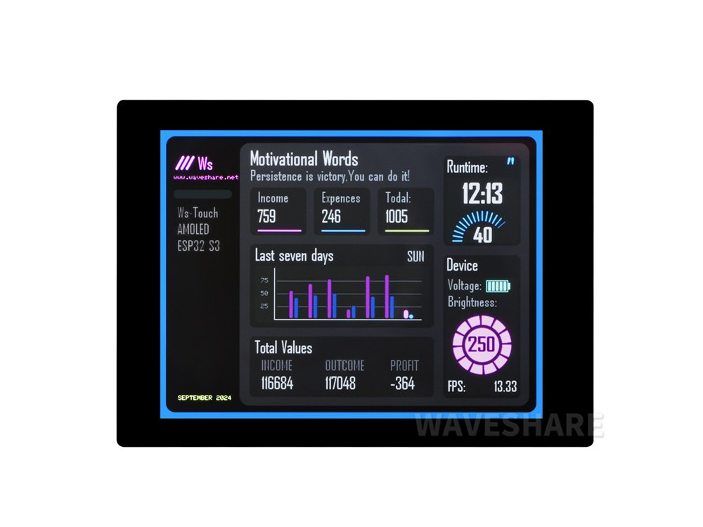

  <h1>ESP32-S3-Touch-AMOLED-2.41-V2</h1>
  
<strong>ESP32-S3 2.41-inch 600 x 450 QSPI AMOLED touch development board (V2)</strong>

  
<strong>English</strong> | <a href="README_ZH.md">简体中文</a>

  

    
    
    
  

  

    <a href="https://www.waveshare.com/esp32-s3-touch-amoled-2.41.htm">🌐 Product</a> &middot;
    <a href="https://github.com/waveshareteam/ESP32-S3-Touch-AMOLED-2.41-V2/releases/latest">📦 Firmware</a> &middot;
    <a href="examples/esp-idf/">🧩 ESP-IDF</a> &middot;
    <a href="examples/arduino/examples/">🔧 Arduino</a> &middot;
    <a href="hardware/">📚 Documentation</a>
  

  

---

## ✨ Overview

This repository provides Arduino and ESP-IDF examples, the factory application and hardware resources for ESP32-S3-Touch-AMOLED-2.41 V2. V1 and V2 use different display, touch and expanded I/O pins; select these programs for a PCB marked Rev2.0.

| Feature | Device / interface |
| --- | --- |
| MCU | ESP32-S3R8, dual-core LX7, up to 240 MHz |
| Memory | 16 MB Flash, 8 MB OPI PSRAM |
| Display | 2.41-inch AMOLED, 600 x 450, QSPI |
| Touch | FT6336 capacitive touch, I2C |
| RTC / IMU | PCF85063 / QMI8658 |
| Expanded I/O | TCA9554 |
| Storage and power | TF card slot, USB Type-C, 3.7 V lithium battery connector |

## 📦 Quick Start

Factory firmware (restores the out-of-box demo): download the file whose name contains `FactoryOnly` from the [`firmware`](firmware/) folder and follow the [flashing instructions](firmware/README.md).

When an example release is available, download its ready-to-flash package from the [latest release](https://github.com/waveshareteam/ESP32-S3-Touch-AMOLED-2.41-V2/releases/latest):

1. Download the `*-combined.zip` for the example and framework version you need.
2. Extract the archive and install esptool with `python -m pip install esptool`.
3. Connect the board over USB.
4. Run `flash_combined.bat COMx` on Windows or `./flash_combined.sh /dev/ttyACM0` on Linux.
5. Reset the board if it does not restart automatically.

## 🧪 Examples

### ESP-IDF

| Example | Main feature |
| --- | --- |
| [01_ADC_Test](examples/esp-idf/01_ADC_Test/) | Battery-voltage ADC |
| [02_I2C_PCF85063](examples/esp-idf/02_I2C_PCF85063/) | RTC date and time |
| [03_I2C_QMI8658](examples/esp-idf/03_I2C_QMI8658/) | Six-axis IMU |
| [04_SD_Card](examples/esp-idf/04_SD_Card/) | TF card mounting |
| [05_WIFI_STA](examples/esp-idf/05_WIFI_STA/) | Wi-Fi station |
| [06_WIFI_AP](examples/esp-idf/06_WIFI_AP/) | Wi-Fi access point |
| [07_EX_GPIO](examples/esp-idf/07_EX_GPIO/) | GPIO loopback |
| [08_Li-ion_Test](examples/esp-idf/08_Li-ion_Test/) | Lithium battery power |
| [09_LVGL_V9_Test](examples/esp-idf/09_LVGL_V9_Test/) | LVGL 9 touch widgets |

### Arduino

| Example | Main feature |
| --- | --- |
| [01_ADC_Test](examples/arduino/examples/01_ADC_Test/) | Battery-voltage ADC |
| [02_I2C_PCF85063](examples/arduino/examples/02_I2C_PCF85063/) | RTC date and time |
| [03_I2C_QMI8658](examples/arduino/examples/03_I2C_QMI8658/) | Six-axis IMU |
| [04_SD_Card](examples/arduino/examples/04_SD_Card/) | TF card mounting |
| [05_WIFI_STA](examples/arduino/examples/05_WIFI_STA/) | Wi-Fi station |
| [06_WIFI_AP](examples/arduino/examples/06_WIFI_AP/) | Wi-Fi access point |
| [07_EX_GPIO](examples/arduino/examples/07_EX_GPIO/) | GPIO loopback |
| [08_Li-ion_Test](examples/arduino/examples/08_Li-ion_Test/) | Lithium battery power |
| [09_LVGL_Test](examples/arduino/examples/09_LVGL_Test/) | LVGL 8 touch widgets |

Sketch libraries are bundled in [`examples/arduino/libraries`](examples/arduino/libraries/), including LVGL 8.4 and `lv_conf.h`. The factory application source is in [`examples/factory`](examples/factory/).

## 🛠️ Development Environment

| Framework | Version | Examples |
| --- | --- | ---: |
| ESP-IDF | `v5.5.6`, `v6.1` | 9 |
| Arduino-ESP32 | `3.3.12` | 9 |
| ESP-IDF (factory application) | `v5.5.4` | 1 |

See [product.json](.github/product.json) for framework versions and Arduino board options; each example directory includes run instructions.

## 📚 Resources

- [V2 schematic](hardware/schematic/)
- [Product page](https://www.waveshare.com/esp32-s3-touch-amoled-2.41.htm)
- [Wiki](https://docs.waveshare.com/ESP32-S3-Touch-AMOLED-2.41/)

## 🤝 Support

- Example or repository problem: [open an issue](https://github.com/waveshareteam/ESP32-S3-Touch-AMOLED-2.41-V2/issues/new/choose).
- Product usage, hardware or order questions: [Waveshare support](https://service.waveshare.com/).

## 📄 License

Apache License 2.0. See [LICENSE](LICENSE); third-party and existing per-file license notices continue to apply.
