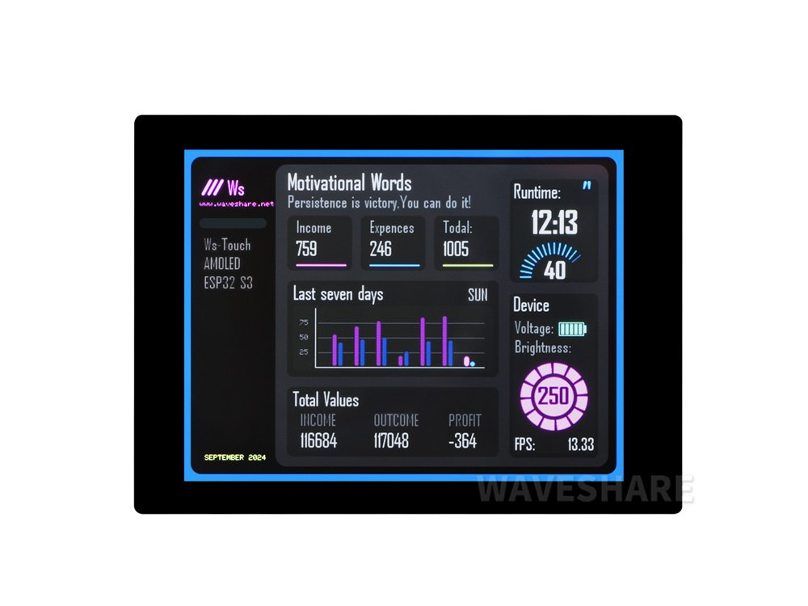

  <h1>ESP32-S3-Touch-AMOLED-2.41-V2</h1>
  
<strong>ESP32-S3 2.41 英寸 600 × 450 QSPI AMOLED 触摸开发板（V2）</strong>

  
<a href="README.md">English</a> | <strong>简体中文</strong>

  

    
    
    
  

  

    <a href="https://www.waveshare.com/esp32-s3-touch-amoled-2.41.htm">🌐 产品</a> &middot;
    <a href="https://github.com/waveshareteam/ESP32-S3-Touch-AMOLED-2.41-V2/releases/latest">📦 固件</a> &middot;
    <a href="examples/esp-idf/">🧩 ESP-IDF</a> &middot;
    <a href="examples/arduino/examples/">🔧 Arduino</a> &middot;
    <a href="hardware/">📚 文档</a>
  

  

---

## ✨ 概述

本仓库提供 ESP32-S3-Touch-AMOLED-2.41 V2 的 Arduino、ESP-IDF 示例、出厂程序和硬件资料。V1 与 V2 的显示、触摸和扩展 I/O 引脚不同，请根据 PCB 的 Rev2.0 标识选择对应程序。

| 功能 | 器件或接口 |
| --- | --- |
| MCU | ESP32-S3R8，双核 LX7，最高 240 MHz |
| 存储器 | 16 MB Flash，8 MB OPI PSRAM |
| 显示 | 2.41 英寸 AMOLED，600 × 450，QSPI |
| 触摸 | FT6336 电容触摸，I2C |
| RTC / IMU | PCF85063 / QMI8658 |
| 扩展 I/O | TCA9554 |
| 存储与供电 | TF 卡槽、USB Type-C、3.7 V 锂电池接口 |

## 📦 快速开始

出厂固件（恢复开箱演示）：在 [`firmware`](firmware/) 目录下载文件名带 `FactoryOnly` 的文件，并按[烧录说明](firmware/README_ZH.md)操作。

示例版本发布后，可在[最新版本](https://github.com/waveshareteam/ESP32-S3-Touch-AMOLED-2.41-V2/releases/latest)下载示例固件包：

1. 下载所需示例和框架版本对应的 `*-combined.zip`。
2. 解压后通过 `python -m pip install esptool` 安装 esptool。
3. 通过 USB 连接开发板。
4. Windows 运行 `flash_combined.bat COMx`，Linux 运行 `./flash_combined.sh /dev/ttyACM0`。
5. 如果开发板未自动重启，请手动复位。

## 🧪 示例

### ESP-IDF

| 示例 | 主要功能 |
| --- | --- |
| [01_ADC_Test](examples/esp-idf/01_ADC_Test/README_ZH.md) | 电池电压 ADC |
| [02_I2C_PCF85063](examples/esp-idf/02_I2C_PCF85063/README_ZH.md) | RTC 日期与时间 |
| [03_I2C_QMI8658](examples/esp-idf/03_I2C_QMI8658/README_ZH.md) | 六轴 IMU |
| [04_SD_Card](examples/esp-idf/04_SD_Card/README_ZH.md) | TF 卡挂载 |
| [05_WIFI_STA](examples/esp-idf/05_WIFI_STA/README_ZH.md) | Wi-Fi STA |
| [06_WIFI_AP](examples/esp-idf/06_WIFI_AP/README_ZH.md) | Wi-Fi AP |
| [07_EX_GPIO](examples/esp-idf/07_EX_GPIO/README_ZH.md) | GPIO 回环测试 |
| [08_Li-ion_Test](examples/esp-idf/08_Li-ion_Test/README_ZH.md) | 锂电池供电 |
| [09_LVGL_V9_Test](examples/esp-idf/09_LVGL_V9_Test/README_ZH.md) | LVGL 9 触摸控件 |

### Arduino

| 示例 | 主要功能 |
| --- | --- |
| [01_ADC_Test](examples/arduino/examples/01_ADC_Test/README_ZH.md) | 电池电压 ADC |
| [02_I2C_PCF85063](examples/arduino/examples/02_I2C_PCF85063/README_ZH.md) | RTC 日期与时间 |
| [03_I2C_QMI8658](examples/arduino/examples/03_I2C_QMI8658/README_ZH.md) | 六轴 IMU |
| [04_SD_Card](examples/arduino/examples/04_SD_Card/README_ZH.md) | TF 卡挂载 |
| [05_WIFI_STA](examples/arduino/examples/05_WIFI_STA/README_ZH.md) | Wi-Fi STA |
| [06_WIFI_AP](examples/arduino/examples/06_WIFI_AP/README_ZH.md) | Wi-Fi AP |
| [07_EX_GPIO](examples/arduino/examples/07_EX_GPIO/README_ZH.md) | GPIO 回环测试 |
| [08_Li-ion_Test](examples/arduino/examples/08_Li-ion_Test/README_ZH.md) | 锂电池供电 |
| [09_LVGL_Test](examples/arduino/examples/09_LVGL_Test/README_ZH.md) | LVGL 8 触摸控件 |

草图使用的库位于 [`examples/arduino/libraries`](examples/arduino/libraries/)，包含 LVGL 8.4 和 `lv_conf.h`。出厂程序源码位于 [`examples/factory`](examples/factory/README_ZH.md)。

## 🛠️ 开发环境

| 开发框架 | 版本 | 示例数 |
| --- | --- | ---: |
| ESP-IDF | `v5.5.6`、`v6.1` | 9 |
| Arduino-ESP32 | `3.3.12` | 9 |
| ESP-IDF（出厂程序） | `v5.5.4` | 1 |

版本与 Arduino 开发板配置见 [product.json](.github/product.json)；每个示例目录提供运行说明。

## 📚 资料

- [V2 原理图](hardware/schematic/)
- [产品页](https://www.waveshare.com/esp32-s3-touch-amoled-2.41.htm)
- [Wiki](https://docs.waveshare.net/ESP32-S3-Touch-AMOLED-2.41/)

## 🤝 支持

- 产品使用、硬件或订单问题：[微雪技术支持](https://docs.waveshare.net/ESP32-S3-Touch-AMOLED-2.41/Technical-Support/)。

## 📄 许可证

Apache License 2.0，详见 [LICENSE](LICENSE)；第三方库及已有文件中的许可证声明继续适用。
